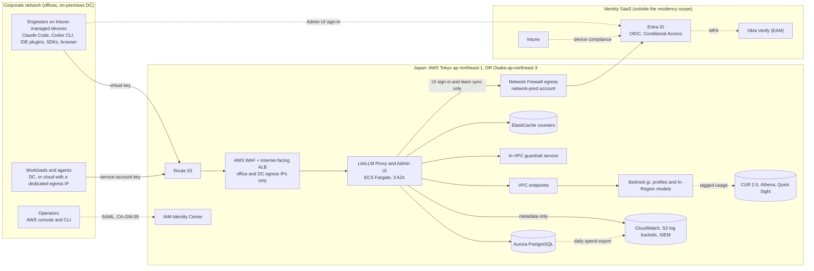
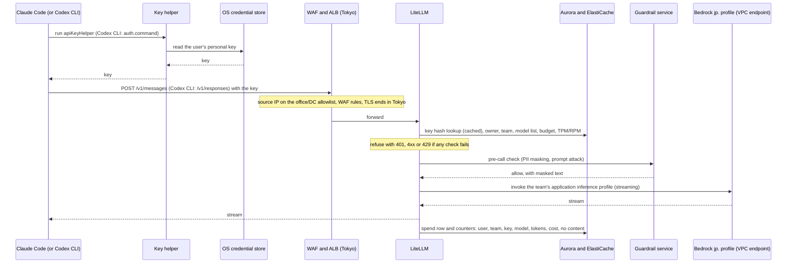
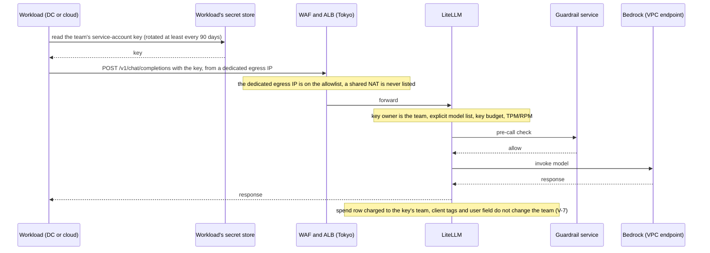
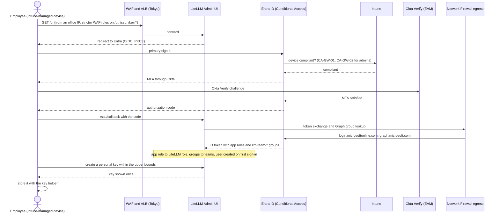
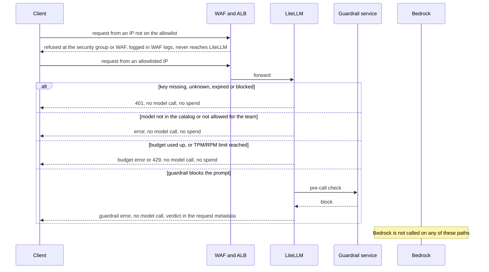

# Internal LLM gateway: Architecture and design specification

| Field | Value |
|---|---|
| Document ID | SPEC-GW |
| Version | 0.1 |
| Status | Draft |
| Owner | TBD (Platform engineering, 2026-12-18): named in 01 Q-1 |
| Approvers | Security, network, platform lead, FinOps, SRE |
| Requirements baseline | REQ-GW 0.1 |
| Source analysis | llm-gateway-comparison commit `46699eb` (2026-11-17) |
| Last updated | 2026-11-17 |

## 1. Overview

### 1.1 Summary

LiteLLM Proxy runs on ECS Fargate in AWS Tokyo, behind an internet-facing ALB and a regional AWS WAF that admit only office and DC egress IPs, with a warm standby in Osaka [CMP §4, §7.2]. Engineers sign in to the LiteLLM Admin UI through Entra ID (Okta Verify MFA, Intune-compliant device) to create a personal virtual key, which Claude Code and Codex CLI read from the OS credential store; workloads use team service-account keys. LiteLLM charges every request to a team, enforces budgets and limits, runs in-VPC guardrails, and calls only Bedrock models processed in Japan through VPC endpoints. No prompt content is stored, and every store, log and export is in Tokyo or Osaka.

### 1.2 Requirements baseline

This design implements REQ-GW version 0.1. Requirements it does not cover yet:

| Requirement | Reason not covered | Planned in |
|---|---|---|
| PRV-002 | The per-team content-logging mechanism is not designed; the comparison leaves it open [CMP §2.8] (R-6, 01 Q-10) | TBD (Platform engineering, 2027-01-29): after Q-10 is answered |
| AVL-001 | Osaka has no designed path to Entra and the licence endpoint, and the Route 53 health check cannot reach an allowlisted ALB [CMP §4.9] (R-7, R-8) | TBD (Platform engineering, 2027-01-29): design version 0.2 |
| MDL-011 | The Azure OpenAI Japan East backend is designed only at the level of [CMP §4.3 step 8]; it is built only if 01 Q-4 requires OpenAI models | TBD (Product owner, 2026-12-18): after 01 Q-4 |

### 1.3 Pinned versions

| Component | Version / image digest | Notes |
|---|---|---|
| LiteLLM proxy | TBD (Platform engineering, 2027-01-29) (R-47) | Enterprise licence [CMP A-6]. The primary sample was pinned to v1.95.0 when the comparison checked it [CMP §3.1]; that is a reference, not our pin. |
| PostgreSQL | Aurora PostgreSQL; engine version TBD (Platform engineering, 2027-01-29) | Provisioned or Serverless v2 is open (R-23) |
| Redis / Valkey | ElastiCache, Valkey or Redis OSS; engine version TBD (Platform engineering, 2027-01-29) | No response cache [CMP §2.8] (R-23) |
| IaC tool | TBD (Platform engineering, 2027-01-29) | CDK (the primary sample) or Terraform (the secondary guidance) [CMP §3.1] (R-22) |
| Guardrail runtime | Presidio, plus a Japanese-capable prompt-attack classifier; versions TBD (Security / SOC, 2027-01-29) | Classifier not chosen [CMP §4.8] (R-10) |

## 2. Architecture

**Satisfies:** RES-001, RES-003, SEC-004, AVL-001, AVL-005, OPS-002, FUN-001, FUN-002, FUN-003, FUN-008, FUN-009, IAM-001, IAM-002, CST-001, RES-004, OBS-002, OBS-003

### 2.1 Context diagram

### 2.2 Component table

| Component | AWS service / resource | Region(s) | Purpose | Satisfies | Owner |
|---|---|---|---|---|---|
| DNS | Route 53 public hosted zone for the gateway hostname, with a failover record | Global service; records point to Tokyo and Osaka | Resolves the gateway name; DNS failover to Osaka [CMP §4.9] | AVL-001, SEC-004 | Platform engineering |
| Ingress | Internet-facing ALB with a regional AWS WAF web ACL; Shield Standard; no CloudFront | ap-northeast-1, ap-northeast-3 | Terminates TLS in Japan, applies the office/DC allowlist and WAF rules, forwards to gateway tasks [CMP §4.2, §4.3] | SEC-001, SEC-004, SEC-006 | Platform engineering |
| Gateway compute | ECS service on Fargate running LiteLLM Proxy and the Admin UI | ap-northeast-1; warm standby in ap-northeast-3 | Authenticates keys, enforces limits, routes to models, writes spend [CMP §4.2] | FUN-001 to FUN-008, IAM-002, CST-001 to CST-005 | Platform engineering |
| Database | Aurora PostgreSQL, Multi-AZ, Global Database to Osaka | ap-northeast-1, replica in ap-northeast-3 | Users, teams, key hashes, budgets, spend logs [CMP §4.7, §4.9] | AVL-002, AVL-M03, OBS-002 | Platform engineering |
| Cache / rate-limit store | ElastiCache (Valkey or Redis OSS), Multi-AZ; no response cache | ap-northeast-1; rebuilt cold in ap-northeast-3 | Shared TPM/RPM and budget counters [CMP §4.2] | CST-003, AVL-006 | Platform engineering |
| Model backend | Bedrock through interface VPC endpoints; application inference profiles copied from `jp.` profiles, and In-Region models | ap-northeast-1, ap-northeast-3 | Models processed only in Japan [CMP §4.3 step 7] | RES-002, SEC-014, MDL-101 | Platform engineering |
| Optional second backend | Azure OpenAI Standard deployments in Japan East, over Direct Connect, the Tokyo colocation router and ExpressRoute private peering | Japan East | OpenAI models, only if 01 Q-4 requires them [CMP §7.2] | MDL-011, SEC-014 | Platform engineering, with Network |
| Guardrails | ECS service in the gateway VPC: Presidio PII masking and a Japanese-capable prompt-attack classifier | ap-northeast-1, ap-northeast-3 | Pre-call checks on every request [CMP §4.8] | SEC-008, SEC-009 | Platform engineering, with Security / SOC |
| Logging / SIEM sink | CloudWatch Logs; S3 log buckets in Tokyo; immutable archive in the log-archive account; cross-account subscription to the SIEM | ap-northeast-1, copies only in ap-northeast-3 | Metadata, audit and infrastructure logs [CMP §4.7] | OBS-001, OBS-004, RES-004 | Platform engineering, with Security / SOC |
| Metrics | Amazon Managed Service for Prometheus and Managed Grafana | ap-northeast-1 | LiteLLM metrics per team and key, alarms [CMP §4.2] | OBS-003, OBS-006 | Platform engineering |
| Secrets | Secrets Manager with customer-managed KMS keys | ap-northeast-1; Osaka copy TBD (Platform engineering, 2027-01-29) (R-7) | Master key, salt key, licence key, DB credentials, SSO client credential, provider keys if any [CMP §4.8] | SEC-010, SEC-012 | Platform engineering |
| Egress control | Default route through Transit Gateway to the inspection VPC in `network-prod`: Network Firewall with a TLS SNI allowlist, and NAT gateway | ap-northeast-1; Osaka not designed (R-7) | Only identity and licence endpoints reachable; no model hostnames [CMP §4.6] | SEC-013, RES-005, FUN-007 | Network |
| Image registry | ECR with enhanced scanning | ap-northeast-1, replicated to ap-northeast-3 | Pinned, scanned LiteLLM and guardrail images [CMP §4.8] | SEC-016 | Platform engineering |
| Residency guardrails | AWS Organizations SCP; AWS Config rule | All regions (deny outside Tokyo and Osaka) | Deny resources and model calls outside Japan [CMP §4.8] | RES-002, RES-003 | Platform engineering, with Security / SOC |
| Operator access | IAM Identity Center federated to Entra, with SCIM | Identity Center home region TBD (Identity, 2027-01-29) (R-45) | Console and CLI access with 1 h admin sessions [CMP §4.4] | IAM-007, IAM-008 | Identity, with Platform engineering |
| Billing and chargeback | CUR 2.0 export, cost allocation tags, AWS Budgets, Athena, Amazon Quick Sight | ap-northeast-1 | Cost truth and monthly chargeback [CMP §4.5] | CST-007, CST-011, RES-004 | FinOps |
| Threat detection | GuardDuty with ECS runtime monitoring, Security Hub, Config rules, IAM Access Analyzer | ap-northeast-1, ap-northeast-3 | Detection and configuration compliance [CMP §4.8] | SEC-019 | Security / SOC |
| Client package | Key helper that prints the personal key from Windows Credential Manager or the macOS Keychain; Claude Code managed settings and Codex CLI `config.toml`, pushed by Intune | Corporate devices | Tools reach the gateway with no user configuration [CMP §2.3.4] | FUN-009 | Endpoint / Intune, with Platform engineering |

### 2.3 Request flows

#### 2.3.1 Interactive call with a personal virtual key

#### 2.3.2 Workload call with a service-account key

#### 2.3.3 Admin UI sign-in

Personal keys are created in this flow, so it is where the device and MFA are checked [CMP §2.2, §2.3.1].

#### 2.3.4 Blocked request

## 3. Interfaces

**Satisfies:** FUN-001, FUN-002, FUN-003, FUN-004, FUN-005, FUN-006, FUN-007, MDL-102, IAM-002, CST-002, CST-005, CST-006, AVL-003, AVL-004, SEC-013, SEC-014, SEC-008, OBS-006

### 3.1 Client-facing API

| API style | Auth modes | Clients | Why exposed | Satisfies |
|---|---|---|---|---|
| Anthropic messages (`/v1/messages`) | Personal virtual key; service-account key | Claude Code; Anthropic SDK | Claude Code calls this API natively [CMP §2.3.4] | FUN-001 |
| OpenAI Responses (`/v1/responses`) | Personal virtual key | Codex CLI | Codex CLI's custom provider uses it [CMP §2.3.4, §10.8.2]; behaviour with non-OpenAI models is unverified (R-4) | FUN-002 |
| OpenAI chat completions (`/v1/chat/completions`) | Personal virtual key; service-account key | IDE plugins, OpenAI SDK, workloads | The common format for SDKs and plugins [CMP §4.3] | FUN-003 |
| OpenAI embeddings (`/v1/embeddings`) | Personal virtual key; service-account key | Workloads | Only if an embedding model is in the catalog (01 Q-5) | FUN-004 |
| Model list (`/v1/models`) | Personal virtual key; service-account key | All | Shows the caller's allowed models | FUN-005 |
| Admin UI and SSO (`/ui`, `/sso/*`) | Entra OIDC session | Browser | Users create their own keys; admins manage the proxy [CMP §2.3.5] | FUN-008, IAM-001 |
| Key management (`/key/*`) | Session (own keys only); CI admin key | Admin UI, CI pipeline | Self-service personal keys; CI-managed team and service-account keys [CMP §2.3, §2.3.5] | TEN-001, TEN-002 |
| Every other LiteLLM route family (images, audio, batches, files, fine-tuning, vector stores, MCP, A2A, pass-through) | — | — | Not exposed: blocked at the WAF and not enabled in LiteLLM until it passes the residency checklist [CMP §10.8.7] | FUN-006 |

Both `x-api-key` and `Authorization: Bearer` must carry the key: Claude Code's `apiKeyHelper` sends both, Codex CLI sends `Authorization: Bearer`, and the primary sample documents that the key check reads `x-api-key` [CMP §2.3.4]. Both are tested against the pinned version (T-001, T-002).

### 3.2 Error behaviour

| Condition | Metered (charged to the team)? | Logged where | Satisfies |
|---|---|---|---|
| Source IP not on the allowlist | No: refused at the security group or WAF | WAF logs, ALB access logs | SEC-001 |
| Authentication failure | No: the request never reaches a model | ALB access log; LiteLLM container log at INFO level, metadata only | IAM-002 |
| Budget exceeded | No: refused before the model call | LiteLLM container log and metrics (failure by team and key); status code is open (R-18) | CST-002 |
| Rate or token limit reached | No: refused before the model call | LiteLLM container log and metrics | CST-003 |
| Guardrail block | No: the guardrail runs before the model call | Guardrail verdict in the request metadata (OBS-002); guardrail service log, metadata only | SEC-008 |
| Upstream model error | Whatever the provider bills; LiteLLM records the failure. Fallback to another Japan deployment first (§5.1) | Request metadata; LiteLLM error log with `disable_error_logs` on, so exceptions are not written to the database (§7.3) | MDL-101, PRV-001 |
| Timeout | LiteLLM's `request_timeout` fires before the ALB, so LiteLLM records it; metering as measured by V-5 | Request metadata; LiteLLM container log | PRF-001, CST-006 |
| Client cancels mid-stream | As measured by V-5; any gap is reported in the monthly residual (§5) | Request metadata; reconciliation report | CST-006 |

### 3.3 External dependencies

| Dependency | Direction | Protocol / endpoint | Failure behaviour | Monitored by |
|---|---|---|---|---|
| Entra ID (OIDC token endpoint, signing keys, Microsoft Graph) | Outbound | HTTPS to `login.microsoftonline.com` and `graph.microsoft.com` through Network Firewall [CMP §4.3, §4.6] | Admin UI sign-in, key creation and team sync fail; API requests with virtual keys do not depend on it. Confirmed by V-10, not run yet. | Alarm on SSO callback failures and Network Firewall drops to these names; threshold TBD (Platform engineering, 2027-01-29) (R-39) |
| LiteLLM licence endpoint | Outbound | HTTPS to `license.litellm.ai` through Network Firewall, unless offline licensing is available [CMP §2.5] (R-19) | What a task restart does while it is unreachable is measured by V-9, not run yet | Alarm on licence check errors in LiteLLM logs (OBS-006) |
| Bedrock | Outbound | `bedrock-runtime` interface VPC endpoint, with an endpoint policy [CMP §4.3] | Throttling or errors: retry with cooldown, then fall back to another Japan deployment (§5.1) | Bedrock CloudWatch metrics; LiteLLM failure metrics per model |
| Azure OpenAI Japan East (only if MDL-011 is required) | Outbound | Private path: Transit Gateway, Direct Connect, the Tokyo colocation router, ExpressRoute private peering, a private endpoint [CMP §4.3 step 8] | Router cooldown and fallback within Japan (§5.1) | LiteLLM failure metrics per model; Direct Connect metrics |
| SIEM | Outbound | Cross-account log subscription from CloudWatch Logs [CMP §4.7]; the SIEM's ingestion path TBD (Security / SOC, 2027-01-29) (R-48) | Logs queue in CloudWatch and S3; the gateway keeps serving | Subscription delivery errors |

## 4. Identity and access

**Satisfies:** IAM-001, IAM-002, IAM-003, IAM-004, IAM-005, IAM-006, IAM-007, IAM-008, IAM-009, TEN-001, TEN-002, TEN-003, TEN-004, TEN-005, TEN-006, FUN-008, FUN-009, SEC-010, SEC-011, SEC-017, OBS-007, REG-004, OBS-005, CST-011

### 4.1 Authentication per client type

| Client type | Auth mode | Token / key source | Lifetime / rotation | Device check |
|---|---|---|---|---|
| Admin UI (browser) | Entra OIDC SSO with LiteLLM's Microsoft SSO settings | Entra app registration per environment (`litellm-prod` in production) [CMP §2.1, §4.4] | LiteLLM session setting; admins sign in again every 4–8 h (CA-GW-02; value in 01 Q-15) | Conditional Access CA-GW-01 or CA-GW-02 at every sign-in |
| Claude Code (engineer) | Personal virtual key | Key helper run by `apiKeyHelper` in managed settings pushed by Intune; key in the OS credential store [CMP §2.3.4] | At most 90 days (TEN-006); default value set in 04 §4.4 (R-16); renewed by the user in the Admin UI | CA-GW-01 when the key is created or renewed; the allowlist on each request while A-16 holds [CMP §2.3.1] |
| Codex CLI (engineer) | Personal virtual key | The same key helper, run by `model_providers.<id>.auth.command` in a user-level `config.toml` pushed by Intune [CMP §2.3.4] | As Claude Code; the helper is re-run every `auth.refresh_interval_ms` | As Claude Code |
| IDE plugins and SDKs that accept only a pasted key | Personal virtual key | The same key, pasted into the tool's settings [CMP §2.3.4] | As Claude Code | As Claude Code |
| Workload or agent (DC or cloud) | Team service-account virtual key | The workload's own secret store (Secrets Manager in the workload's account, read with its IAM role) [CMP §4.4] | At most 90 days; rotated by the owning team | None on the device; network scoping to a dedicated egress IP or the private path [CMP §2.3.5] |
| CI pipeline (key and team management API) | Admin virtual key | Secrets Manager in the gateway account [CMP §2.3] | Rotation schedule TBD (Security / SOC, 2027-01-29) (R-48) | Fixed CI egress IPs on the allowlist; stricter WAF rules on `/key/*` |
| Any client, only if mTLS becomes required (SEC-003) | Intune device certificate or AWS Private CA workload certificate, in addition to the key | Intune certificate profile with a non-exportable key [CMP §2.3.2] | 30–90 days, auto-renewed | ALB mTLS verify mode on every connection |

### 4.2 Authorization and role mapping

| Entra group / claim | LiteLLM role / team | Permissions | Provisioning (SCIM / JIT) |
|---|---|---|---|
| App role `proxy_admin` | Role `proxy_admin` | Manage teams, users, models and all keys; production changes still go through CI (OPS-003) | Role applied at each sign-in; highest role wins [CMP §2.4] |
| App role `proxy_admin_viewer` | Role `proxy_admin_viewer` | Read-only view of the proxy | As above |
| App role `internal_user` | Role `internal_user` | Create, list and delete own personal keys within the upper bounds; see own usage [CMP §2.3.5] | User created at first sign-in (JIT); deprovisioned by SCIM [CMP §2.4] |
| App role `internal_user_viewer` | Role `internal_user_viewer` | View own usage only | As `internal_user` |
| Security group `llm-team-<team>`, assigned to the app | Team `<team>` | Models in the team's access groups, within the team budget and TPM/RPM; team admins create team and service-account keys | Team sync from the group claim at each sign-in [CMP §4.4]; budgets and limits set by CI. Group naming is inconsistent in the comparison (R-15). |
| Department mapping | LiteLLM organization, or a `dept:<code>` tag on every team and key | Department budget and reporting | Open: organization or tag [CMP §2.4, §4.5] (R-14) |

### 4.3 Operator access (cloud console and break-glass)

| Item | Design |
|---|---|
| Permission sets per environment | TBD (Platform engineering, 2027-01-29) (R-45) |
| Session length | 1 h for admin permission sets [CMP §4.4] |
| Source-IP conditions | Deny calls whose `aws:SourceIp` is not an office or DC egress IP, with an `aws:ViaAWSService` exception, in an SCP or the permission-set policy [CMP §4.4] |
| Break-glass access | IAM users whose credentials are kept in a vault [CMP §4.4]; who can open the vault TBD (Security / SOC, 2027-01-29) (R-45) |
| Audit of operator and break-glass use | CloudTrail organization trail, home region Tokyo, delivered to the SIEM; any break-glass sign-in alerts Security; review frequency TBD (Security / SOC, 2026-12-18) (01 Q-8) |
| Interactive access to tasks | None: ECS Exec disabled in production [CMP §4.4] |
| CLI sign-in | `aws sso login` with a browser on the same machine; `--use-device-code` blocked by CA-GW-05 [CMP §4.4] |

### 4.4 Conditional Access policies

The policy set is defined in [CMP §2.1]; this design adopts it unchanged.

| Policy | Applies to | Satisfies |
|---|---|---|
| CA-GW-01 | All users of `litellm-prod`: MFA through Okta EAM and a compliant device | IAM-001 |
| CA-GW-02 | `proxy_admin` holders: as CA-GW-01, plus phishing-resistant MFA where available and a 4–8 h sign-in frequency | IAM-003 |
| CA-GW-03 | Workload identities | n/a: not used, because workloads use service-account keys [CMP §2.1] |
| CA-GW-04 | `litellm-prod`: block legacy authentication and device-code flow | IAM-005 |
| CA-GW-05 | IAM Identity Center enterprise app: phishing-resistant MFA, compliant device, office/DC named locations, 4–8 h sign-in frequency, device-code flow blocked | IAM-005, IAM-007 |

### 4.5 Key issuance and lifecycle

| Item | Design |
|---|---|
| Personal keys | Created by the user in the Admin UI after an Entra sign-in; only for themselves; owner is the user [CMP §2.3.5] |
| Upper bounds | `upperbound_key_generate_params`: maximum `duration` 90 days, plus budget and TPM/RPM bounds. Values: 04 §4.4. Above-bound requests are rejected, not clamped [CMP §2.3.5]; V-2 checks this. |
| Who creates which key | `key_generation_settings`: users create personal keys for themselves only; team and service-account keys only by team admins or CI [CMP §2.3.5]. Whether team admins may do this by hand in production is open (R-25). |
| One active personal key per user | Policy, backed by user-level budget and TPM/RPM that apply across all of a user's keys (V-2) |
| Leavers | SCIM deprovisioning; if the pinned version does not block a deprovisioned user's keys, an offboarding job blocks them when Entra disables the account [CMP §2.4] (R-35); time target 01 Q-8 |
| Key sharing | Forbidden by the acceptable-use policy; SIEM alert when one key is used from several IPs or user agents [CMP §2.3.3] |
| Master key | Only in Secrets Manager; no routine human use; rotated by new value and restart of every task, on a schedule and when an admin leaves; readers reviewed as proxy admins [CMP §2.3.5]. UI password login checked by V-3 (R-2). |
| Without the Enterprise licence | Users request keys through a workflow and CI creates them [CMP A-6, §2.3.5] (R-36) |

## 5. Tenancy, cost allocation and limits

**Satisfies:** TEN-003, TEN-004, CST-001, CST-002, CST-003, CST-004, CST-005, CST-006, CST-007, CST-008, CST-009, CST-010, CST-011, FUN-005, MDL-101, MDL-102, MDL-103, MDL-104, MDL-105, RES-002, OPS-003, FUN-004

| Item | Design |
|---|---|
| Team model | One LiteLLM team per Entra group `llm-team-*`; departments as organizations or tags (R-14) [CMP §2.4] |
| Budget enforcement | Hard: requests over budget are refused before the model call [CMP §4.3 step 5]. Team `budget_duration: 30d`, a rolling period, while chargeback is by calendar month (01 Q-12) [CMP §4.5]. User and key budgets as well. Team admins notified at 80 % and 100 % by email or chat with no prompt content (CST-010); channel TBD (Product owner, 2027-01-29). AWS Budgets on the account and per `CostCenter` tag as a backstop [CMP §4.5]. |
| Rate and token limits | TPM/RPM per key, user and team, held in Redis so they apply across tasks; `max_tokens` caps per model; model access groups per team [CMP §4.5]. The WAF's per-IP rule is only a flood cap above the office's peak, because users share NAT IPs [CMP §2.7]. Values: 04 §4.4. |
| Tagging | Application inference profiles copied from `jp.` profiles (or In-Region models), tagged `CostCenter` and `Team`; tags activated for cost allocation [CMP §4.5]. Per-department or per-team profiles is open (R-12). |
| Pricing source | LiteLLM runs with `LITELLM_OFFLINE_MODE=true`, so the price map is the one in the image [CMP §2.5]. Every deployment that is an application inference profile ARN, or is missing from that map, gets custom per-model pricing (R-5). V-4 checks every deployment, with and without prompt caching. |
| Reconciliation with AWS billing (CUR) | Each team's charge is the CUR total for the model service times the team's share of LiteLLM-recorded cost; the residual is its own line, investigated above a threshold (01 Q-12) [CMP §4.5]. A daily job exports spend by team, tag and model to S3 in Tokyo; Athena and Quick Sight join it with CUR 2.0 [CMP §4.3 step 12]. |
| Fixed-cost components | Guardrail service, SageMaker endpoints if any, private-line share if any: platform overhead or custom pricing, decided before launch (01 Q-12) [CMP §4.5] |
| Budget overshoot bound | Concurrent requests allowed per user or key, times the most expensive request allowed (`max_tokens` and the request size limit); written into the budget policy (CST-009) [CMP §2.4] |
| Client-set attribution | `global_disable_no_log_param: true` (V-6). Request-body tags and the `user` field do not change the charged team (V-7); whether they are kept for per-person showback in chat front-ends is open (R-26) |

### 5.1 Model backends and routing

Public model names are a proposal (D-20). Which rows are built depends on 01 Q-4. Profile ARNs, quotas and prices are set in 04 §4.1.

| Public model name (what clients send) | Backend (provider, profile or model, region) | Fallback order | DR-region deployment | Satisfies |
|---|---|---|---|---|
| `claude-opus-5-5` (alias `claude-opus`) | Bedrock application inference profile in Tokyo, copied from the `jp.` Claude Opus 5.5 profile | `claude-opus-4-8` [CMP §4.9] | The same `jp.` profile, called from Osaka with its own quota | MDL-001, MDL-101 |
| `claude-haiku-5-5` (alias `claude-haiku`) | Application inference profile from the `jp.` Claude Haiku 5.5 profile | `claude-haiku-4-5` (proposed) | The same `jp.` profile from Osaka | MDL-002, MDL-101 |
| `claude-opus-4-8` | Application inference profile from the `jp.` Claude Opus 4.8 profile | None | The same `jp.` profile from Osaka | MDL-003 |
| `claude-sonnet-4-6` | Application inference profile from the `jp.` Claude Sonnet 4.6 profile | None | The same `jp.` profile from Osaka | MDL-004 |
| `claude-haiku-4-5` | Application inference profile from the `jp.` Claude Haiku 4.5 profile | None | The same `jp.` profile from Osaka | MDL-005 |
| `nova-2-lite` | Application inference profile from the `jp.` Amazon Nova 2 Lite profile | None | The same `jp.` profile from Osaka | MDL-006 |
| `titan-embed-text-v2` | Bedrock In-Region model, Tokyo | None: an embedding model cannot be swapped without re-indexing [CMP §4.9] | Not checked (R-9) | MDL-007 |
| `cohere-embed-v4` | Bedrock In-Region model, Tokyo | None | Not checked (R-9) | MDL-008 |
| `mistral-large-3` | Bedrock In-Region model, Tokyo | None | Not checked (R-9) | MDL-009 |
| `gpt-oss-120b` | Bedrock In-Region model, Tokyo | None | Not checked (R-9) | MDL-010 |
| OpenAI model names, only if MDL-011 is required | Azure OpenAI Standard deployment, Japan East, over the private path | Japan-processed deployments only | Not checked (R-9) | MDL-011 |

| Item | Design |
|---|---|
| Router strategy, retries and timeouts per model | Retries with `cooldown` on 429 and 5xx, then fallback [CMP §4.9]; routing strategy TBD (Platform engineering, 2027-01-29) (R-49). Values: 04 §4.4. |
| How a fallback is kept in Japan | Fallbacks name only catalog deployments processed in Japan; the task-role and VPC endpoint policies allow only `jp.` profiles, In-Region models and our application inference profiles in Tokyo and Osaka; the SCP denies `global.` and `apac.` profiles even if one is configured [CMP §4.3 step 7, §4.8] |
| What happens to model names that are not in the catalog | Refused; there is no default or wildcard model (MDL-102) |
| Per-team access | Model access groups (for example `tier-standard`, `tier-premium`) granted per team [CMP §2.4]; keys carry an explicit model list |
| Onboarding a model | `GetInferenceProfile` from each source Region must show only Tokyo and Osaka destinations; the result and date are recorded; re-checked every quarter [CMP §4.8, §7.2] |
| Where model definitions live | `config.yaml` in Git, deployed by CI; `STORE_MODEL_IN_DB` off in production (D-19) |

## 6. Networking

**Satisfies:** SEC-001, SEC-002, SEC-003, SEC-004, SEC-005, SEC-013, SEC-014, RES-005, FUN-007, PRF-001, OPS-005, PRF-M03, OPS-004

| Item | Design |
|---|---|
| VPC CIDRs (Tokyo / Osaka) | Tokyo `llm-gateway-prod` VPC `10.60.0.0/20` across 3 AZs, as given in [CMP §4.6], to be checked against the corporate address plan (R-33); subnets `public` /26 ×3 (ALB), `app` /24 ×3 (tasks), `data` /26 ×3 (Aurora, ElastiCache), `endpoints` /26 ×3. Osaka CIDR TBD (Network, 2027-01-29) (R-33). |
| Ingress routes and allowlist source | Route B only: internet, regional WAF, internet-facing ALB [CMP §4.6]. The ALB security group allows 443 only from the office and DC egress CIDRs, never `0.0.0.0/0`; the WAF IP set repeats the list. The list comes from Network, with an owner per CIDR, and is re-checked by V-11 (01 Q-14). Route A is not built (01 NG-5). |
| mTLS (trust store, CA, revocation) | Not adopted: not needed while A-16 holds; V-11 decides [CMP §2.3.2]. If required: ALB mutual authentication verify mode, trust store with the Intune issuing CA and AWS Private CA, CRL published to S3 by a scheduled job, certificates valid 30–90 days, non-exportable keys, a local mTLS helper for CLIs [CMP §2.3.4, §4.8] (R-3). |
| TLS policy and certificates | ALB security policy `ELBSecurityPolicy-TLS13-1-2-2021-06`; ACM certificate for the gateway hostname [CMP §4.8] |
| Timeout design (which layer fires first) | LiteLLM times out before the ALB, so that LiteLLM logs the error: ALB idle timeout 600 s, LiteLLM `request_timeout` 570 s, target group deregistration delay at least 600 s [CMP §2.7, §4.9]. Values: 04 §4.3. |
| Egress control and allowed FQDNs | No IGW route from the app subnets; default route through Transit Gateway to the inspection VPC in `network-prod`. Network Firewall allows TLS SNI `login.microsoftonline.com`, `graph.microsoft.com`, and the licence endpoint if needed; no model provider hostname; everything else denied and logged [CMP §4.6]. Limits and checks: R-20. |
| VPC endpoints | Interface endpoints for `bedrock-runtime`, `bedrock`, `sagemaker.runtime` (only if self-hosted models are added), `secretsmanager`, `kms`, `logs`, `monitoring`, `sts`, `ecr.api`, `ecr.dkr`, `elasticloadbalancing`; S3 gateway endpoint; private DNS on [CMP §4.6] |
| Security groups | ALB: 443 from the allowlist; tasks: 4000 from the ALB only; data: 5432 and 6379 from the tasks only; endpoints: 443 from the tasks [CMP §4.6] |
| DNS | Route 53 public record for the gateway hostname (01 Q-14), failover record to Osaka; split-horizon only if Route A is added [CMP §4.6, §4.9] |
| Fixed destination IPs | If the office firewall cannot allow by FQDN, put AWS Global Accelerator in front of the ALB, or use Route A [CMP §2.6] (R-32) |
| Callers inside AWS | Agents in AWS use a dedicated egress IP on the allowlist, never the shared NAT in `network-prod` [CMP §4.4] |
| Image inputs | URL images cannot be fetched because egress is allowlisted; clients send images inline [CMP §2.5] |

## 7. Data and logging

**Satisfies:** PRV-001, PRV-003, PRV-004, RES-001, RES-004, OBS-001, OBS-002, OBS-003, OBS-004, OBS-005, OBS-006, OBS-007, SEC-015, AVL-M03, AVL-M04, REG-003, TEN-003

### 7.1 Data stores

| Store | Contents | Contains prompt content? | Encryption (KMS key) | How retention (01 §8) is enforced | Backup / replication region | Access |
|---|---|---|---|---|---|---|
| LiteLLM database (Aurora PostgreSQL, Tokyo) | Users, teams, key hashes, budgets; spend logs for 90 days | No | Customer-managed KMS key; TLS required (`rds.force_ssl`) | A daily job exports spend rows to S3 as Parquet, then deletes rows older than 90 days once the export has succeeded [CMP §4.7]; table sizing open (R-1) | PITR 35 days; Aurora Global Database to Osaka; daily snapshot copied to Osaka [CMP §4.7, §4.9] | Gateway task role; platform admins through IAM DB authentication [CMP §4.4] |
| Counter store (ElastiCache, Tokyo) | TPM/RPM and budget counters; no response cache | No | Customer-managed KMS key; encryption in transit; AUTH/RBAC | Ephemeral | None; rebuilt cold in Osaka [CMP §4.9] | Gateway tasks only |
| Request metadata bucket (S3, Tokyo) | Metadata written by the LiteLLM S3 logging callback with `turn_off_message_logging: true` | No | SSE-KMS, customer-managed key | Lifecycle: 1 year, then Glacier until 7 years (01 §8, open in 01 Q-9); Object Lock governance mode, enabled only after V-1 passes [CMP §4.7] | Replication to Osaka TBD (Platform engineering, 2027-01-29) | Bucket policy restricted to the VPC endpoint; read by Athena roles |
| Spend export bucket (S3, Tokyo) | Daily spend export by team, tag and model | No | SSE-KMS, customer-managed key | Lifecycle per 01 §8 (7 years open in 01 Q-9) | Replication to Osaka TBD (Platform engineering, 2027-01-29) | Export job; FinOps through Athena |
| Audit archive (S3 in the log-archive account) | LiteLLM audit log, CloudTrail organization trail | No | SSE-KMS, customer-managed key | Object Lock; 7 years [CMP §4.7] | TBD (Security / SOC, 2027-01-29) (R-48) | Security / SOC |
| CloudWatch Logs (Tokyo) | Container logs at `LITELLM_LOG=INFO`; ALB, WAF, Network Firewall and VPC Flow Logs | No: V-1 checks container and WAF logs | Customer-managed KMS key | 90 days, then archived to S3 for the period in 01 §8 [CMP §4.7] | Not replicated | Platform operators; subscription to the SIEM |
| CUR 2.0 export bucket (S3, Tokyo) | AWS cost and usage, with inference-profile tags | No | SSE-KMS | Lifecycle per 01 §8 (open in 01 Q-9) | Not replicated | FinOps |
| Opt-in content store | Not designed (R-6) | Yes | A separate KMS key and access role; Macie scanning [CMP §4.7] | Per team's legal requirement, 30 days by default [CMP §4.7] | Japan only | TBD (Legal / privacy, 2026-12-18) (01 Q-10) |
| Secrets Manager (Tokyo) | Master key, salt key, licence key, DB credentials, SSO client credential | No | Customer-managed KMS key | n/a: secrets are rotated, not retained | Osaka copy TBD (Platform engineering, 2027-01-29) (R-7) | Gateway task execution role; platform admins, reviewed as proxy admins |

### 7.2 Core entities

| Entity | Meaning here | Source of truth | Created by | Key fields we rely on |
|---|---|---|---|---|
| Team | A cost centre that is charged | Entra group `llm-team-*`, synced | Team sync at sign-in; budgets and access groups set by CI | team_id, alias, budget, models allowed |
| User | An employee | Entra ID | JIT at first Admin UI sign-in; deprovisioned by SCIM [CMP §2.4] | user_id (UPN or object ID), role, teams |
| Virtual key | A credential for a person's tools or a workload | LiteLLM DB | Personal keys: the user in the Admin UI; team and service-account keys: team admins or CI [CMP §2.3.5] | key alias, owner, team, expiry, model list, budget, TPM/RPM |
| Spend log row | One request's metadata and cost | LiteLLM DB, exported to S3 | Gateway | request_id, user, team, key, model, tokens, cost, status, tags, guardrail result |
| Model deployment | A public model name mapped to a backend | `config.yaml` in Git (D-19) | Platform team, through CI | model_name, backend ID (profile ARN in `model_id`, base model in `model` [CMP §4.3 step 7]), pricing |
| Organization or department tag | A department, for chargeback | Open (R-14) | CI | org_id or `dept:<code>`, budget |

### 7.3 Content handling

| Where content may exist | When | Who can read it | Proven by |
|---|---|---|---|
| Nowhere at rest | Default for every team [CMP A-10] | — | V-1 |
| Opt-in content store | Not designed; no team is enabled until it is designed and V-1 passes with that team's configuration [CMP §2.8] | TBD (Legal / privacy, 2026-12-18) (01 Q-10) | V-1, run with that team's configuration |
| In memory in LiteLLM and guardrail tasks | During the request | No person: no interactive access to tasks (ECS Exec off) | — |
| Inside Bedrock | During the model call | AWS, under contract; Bedrock does not store or log prompts and completions [CMP §2.8] | n/a: provider's documentation [CMP §2.8] |

The settings that keep content out of each store, from [CMP §2.8], are: `store_prompts_in_spend_logs: false`; `turn_off_message_logging: true`; `global_disable_no_log_param: true`; `disable_error_logs: true`; `LITELLM_LOG=INFO`; no response cache; `allow_client_message_redaction_opt_out` never set outside approved opt-in teams; Bedrock model invocation logging off in both regions (D-13); guardrail service logs metadata only; WAF logs redact `authorization` and `x-api-key`. Values: 04 §4.2, which needs rows for the settings it does not list yet (R-21).

### 7.4 Log pipeline and audit events

| Event | Fields | Destination | Reviewed by (who, how often) |
|---|---|---|---|
| Virtual key created, changed or deleted | Admin or user, key alias, owner, team, expiry, models, time | LiteLLM audit log, then S3 in the log-archive account, then the SIEM | Security / SOC; frequency TBD (Security / SOC, 2026-12-18) (01 Q-8) |
| Team, budget, model access or model configuration changed | Actor, object, old and new values, time | LiteLLM audit log, CI pipeline log, then the SIEM | Security / SOC and Platform engineering; frequency TBD (Security / SOC, 2026-12-18) (01 Q-8) |
| Request completed or refused | request_id, user, team, key alias, model, tokens, cost, latency, status, guardrail result | Aurora spend log; S3 metadata bucket; daily export to Athena | FinOps monthly (reconciliation); Security / SOC through SIEM queries |
| One key used from several IPs or user agents | Key alias, owner, IPs, user agents, time window | SIEM correlation on request metadata and ALB logs | Security / SOC, on alert |
| Admin UI sign-in | User, result, device compliance, MFA | Entra sign-in logs, then the SIEM | Identity and Security / SOC, on alert |
| WAF block or allowlist refusal | Rule, source IP, path, time; credential headers redacted | WAF logs in CloudWatch, then the SIEM | Security / SOC, on alert (spike) |
| Egress denied | Source, destination SNI and IP, time | Network Firewall alert logs, then the SIEM | Security / SOC, on alert |
| Operator AWS API call, including break-glass | Principal, action, source IP, time | CloudTrail organization trail, then the log-archive account and the SIEM | Security / SOC; break-glass on alert; others TBD (Security / SOC, 2026-12-18) (01 Q-8) |
| Threat finding | Finding type, resource, severity | GuardDuty and Security Hub, then the SIEM | Security / SOC, on alert |

### 7.5 Schema changes

| Item | Design |
|---|---|
| How migrations run | LiteLLM applies Prisma migrations when the new version starts |
| Whether a migration can be rolled back | Assumed not. The rollback is a restore from the snapshot taken just before the upgrade, which loses spend rows written since (R-30) |
| Who reviews migrations before an upgrade | Platform engineering, as part of the upgrade steps in 09 §3.1 |

## 8. Security controls

**Satisfies:** SEC-001, SEC-004, SEC-006, SEC-007, SEC-008, SEC-009, SEC-010, SEC-012, SEC-013, SEC-015, SEC-016, SEC-017, SEC-018, SEC-019, RES-002, RES-003, RES-006, RES-007, REG-001, REG-002, REG-004, PRV-003, CST-009, MDL-101, FUN-006, RES-005, REG-003

| Control | Implementation | Threat addressed | Satisfies |
|---|---|---|---|
| WAF rule set tuned for LLM bodies | Office/DC IP set, per-IP rate rule as a flood cap, Amazon IP reputation, Known Bad Inputs, and the Core rule set with `SizeRestrictions_BODY` set to Count on the API paths; body XSS, LFI and RFI rules reviewed for false positives on code; a stricter rule set on `/ui`, `/sso` and `/key/*` [CMP §4.8] | Access from outside our network; attacks on admin paths; floods | SEC-001, SEC-006 |
| Request size limit | `max_request_size_mb` in LiteLLM, because the WAF inspects only the first 8 KB [CMP §2.7]; value open (R-17) | Oversized requests; budget overshoot | SEC-007, CST-009 |
| Guardrails | In-VPC service called pre-call by LiteLLM for every model: Presidio PII masking, and a Japanese-capable prompt-attack and content classifier [CMP §4.8]. Post-call checks and failure behaviour open (R-11). | Personal data sent to models; prompt injection and jailbreaks | SEC-008, SEC-009 |
| Secrets management and master key handling | Secrets Manager with customer-managed KMS keys, injected only as ECS secrets; automatic rotation of the DB credential; provider keys (if any) every 90 days; master key as in §4.5; salt key never rotated without a re-encryption plan [CMP §4.8] | Credential theft; loss of stored credentials | SEC-010, SEC-012 |
| Region-deny SCP | Deny actions outside `ap-northeast-1` and `ap-northeast-3`, except global services; deny `bedrock:InvokeModel*` on `global.*` and `apac.*` profiles; AWS Config rule flags resources elsewhere [CMP §4.8] | Data processed or stored outside Japan | RES-002, RES-003 |
| Model access restriction | Task-role and VPC endpoint policies allow only `jp.` profiles, In-Region models and our application inference profiles in Tokyo and Osaka [CMP §2.5, §4.3] | A configured fallback or model outside Japan | RES-002, MDL-101 |
| Egress allowlist | Network Firewall SNI allowlist with no model hostnames (§6) | Data sent to unapproved destinations | SEC-013, RES-005 |
| Container image scanning and signing | Image pinned by digest, mirrored to ECR, ECR enhanced scanning (Inspector), promoted dev, staging, production [CMP §4.8]. Image signing is not in the comparison: TBD (Platform engineering, 2027-01-29) (R-43). | Vulnerable or tampered images | SEC-016 |
| Credential redaction in logs | WAF logging redacts `authorization` and `x-api-key` [CMP §2.8] | Keys copied from logs | SEC-015 |
| Secret scanning | Push protection for the virtual key format on source repositories [CMP §2.3.6] | Keys leaked to Git | SEC-018 |
| Threat detection | GuardDuty (with ECS runtime monitoring), Security Hub, Config rules, IAM Access Analyzer, findings to the SIEM [CMP §4.8] | Compromise of the account or tasks | SEC-019 |
| No interactive task access | ECS Exec disabled in production [CMP §4.4] | Reading content from task memory | SEC-017 |
| Client residency settings | Per client, vendor telemetry turned off through managed settings where possible; public model APIs and consumer AI blocked on the secure web gateway [CMP §2.5 rule 5] | Prompts sent around the gateway | RES-006, RES-007 |
| Provider approval | Each backend needs written legal and security approval before it is configured; abuse-monitoring storage checked [CMP A-7, A-12] | Unapproved providers | REG-001, REG-002 |

### 8.1 Threat model summary

Threats follow the table in [CMP §2.3.6], plus the threats from [CMP §2.5], §2.8 and §4.6. No residual risk has been accepted yet; acceptance of every row is tracked as R-48.

| Threat | Mitigation | Residual risk | Accepted by |
|---|---|---|---|
| A key leaks to the internet and is used from outside | IP allowlist; secret scanning | None while the allowlist holds [CMP §2.3.6] | TBD (Security / SOC, 2027-01-29) |
| A copied key is used from an unmanaged device behind an office IP | A-16 tested by V-11; mTLS if it fails (SEC-003) | The key works until it expires if A-16 is wrong and V-11 misses it (R-3) | TBD (Security / SOC, 2027-01-29) |
| Malware or a prompt-injected agent uses the key on the managed laptop | EDR; per-key budget, TPM/RPM and model list | Not blocked by any authentication option [CMP §2.3.6] | TBD (Security / SOC, 2027-01-29) |
| A leaver's key stays valid | SCIM or offboarding job (§4.5) | Window between disablement and blocking (01 Q-8, R-35) | TBD (Security / SOC, 2027-01-29) |
| A user shares a key with a colleague | Acceptable-use policy; SIEM alert on several IPs or user agents | Wrong attribution until detected; no data loss [CMP §2.3.3] | TBD (Security / SOC, 2027-01-29) |
| A workload behind a shared NAT uses a stolen key | Dedicated egress IPs only on the allowlist | None while V-11's CIDR list holds | TBD (Security / SOC, 2027-01-29) |
| The corporate proxy reads prompts and keys | TLS-inspection exemption (SEC-005) | None once the exemption is confirmed | TBD (Security / SOC, 2027-01-29) |
| Master-key login on the Admin UI from an allowlisted IP | Secret handling; V-3 | If V-3 shows it cannot be turned off, only secret handling protects it (R-2) | TBD (Security / SOC, 2027-01-29) |
| Prompt content lands in a log or store | Settings in §7.3; V-1 before Object Lock | A LiteLLM upgrade changes logging; V-1 re-runs on every upgrade | TBD (Security / SOC, 2027-01-29) |
| A configuration change routes prompts outside Japan | SCP and task-role policy deny non-Japan profiles; fallbacks inspected | None at the model layer while the SCP holds | TBD (Security / SOC, 2027-01-29) |
| A compromised task sends data out through allowed Entra hostnames | Egress allowlist; GuardDuty | The allowlisted hostnames serve every Entra tenant [CMP §4.6] (R-20) | TBD (Security / SOC, 2027-01-29) |
| A user overspends or misuses tools | Budgets, TPM/RPM, model access groups, alerts | Overshoot bounded by CST-009 | TBD (Security / SOC, 2027-01-29) |

### 8.2 Compliance

| Standard / regulation / internal policy | Applies because | Evidence | Owner |
|---|---|---|---|
| APPI (Japan personal information) | Per-user metadata is personal data [CMP §2.8] | The privacy agreement in PRV-003; retention approval (REG-003) | Legal / privacy |
| Internal AI use policy and acceptable-use policy | Users must not share keys or send data the policy forbids [CMP §2.3.3] | Policy link in 11 §B and acceptance records (REG-004); existence open (01 Q-18) | Legal / privacy |
| ISO 27001 / SOC 2 controls, if in scope | TBD (Security / SOC, 2026-12-18) (01 Q-19) | TBD (Security / SOC, 2026-12-18) | Security / SOC |

### 8.3 Vulnerability management

| Item | Design |
|---|---|
| Image scanning | ECR enhanced scanning (Inspector) [CMP §4.8]; deploys blocked at severity TBD (Security / SOC, 2027-01-29) (R-48) |
| LiteLLM security advisories | Platform engineering watches them [CMP §7.3]; patch time by severity TBD (Security / SOC, 2027-01-29) (R-48) |
| Penetration test | Not run; first test before launch, date TBD (Security / SOC, 2027-01-29) (R-48) |
| Reporting a vulnerability | Security / SOC (contact in 11 §C) |

## 9. Availability, scaling and DR

**Satisfies:** AVL-M01, AVL-M02, AVL-M03, AVL-001, AVL-002, AVL-003, AVL-004, AVL-005, AVL-006, PRF-M01, PRF-M02, PRF-M03, PRF-M04, PRF-001, OBS-006, OPS-007

| Item | Design |
|---|---|
| Task count (minimum / maximum) and scaling metric | At least 3 tasks; target tracking on CPU (about 60 %) and ALB `RequestCountPerTarget`; Uvicorn workers equal to vCPU count [CMP §4.9]; maximum and task size TBD (Platform engineering, 2027-01-29) (R-42) |
| AZ spread | 3 AZs [CMP §4.9] |
| Database HA and failover time | Aurora Multi-AZ with a reader for the UI and analytics [CMP §4.9]; failover time and caller impact from V-8, not run yet |
| Behaviour when the database, Redis, Entra or the licence endpoint is down | Database: from V-8; `allow_requests_on_db_unavailable` stays `false` unless V-8 shows a reason, because Route B is internet-facing [CMP V-8]. Redis: limits degrade; alert (AVL-006). Entra: API traffic continues, sign-in fails (V-10). Licence endpoint: from V-9; do not restart tasks while it is unreachable unless V-9 shows that is safe. None of these gates has run. |
| DR mode (Osaka) | Warm standby deployed from the same IaC; Aurora Global Database Tokyo to Osaka; Route 53 failover record; the same allowlist and WAF rules on the Osaka ALB; Redis rebuilt cold [CMP §4.9] |
| Failover trigger and decision owner | TBD (Product owner, 2027-01-29) (R-44). Procedure: 07 §4.1. |
| Models without DR | The In-Region Tokyo models (MDL-007 to MDL-010) unless they exist in Osaka; users get an error for those models after failover (R-9). Availability per model: 01 §6.5. |
| Capacity plan (Bedrock TPM and RPM quotas per model, per Region) | Sized from 01 PRF-M02 and PRF-M04 once set; quota values TBD (Platform engineering, 2027-01-29) (R-27). Quotas for `jp.` profiles apply per source Region, so Osaka needs its own [CMP §4.5]. |
| Health check for failover | Route 53 health checkers cannot reach an ALB that admits only office IPs; allow their ranges on the health path only, or fail over on a CloudWatch alarm (R-8) [CMP §4.9] |
| Osaka egress | Not designed: Osaka needs its own path to Entra and the licence endpoint (R-7) [CMP §4.9] |

## 10. Deployment design

**Satisfies:** OPS-001, OPS-002, OPS-003, OPS-004, OPS-006, OPS-007, OPS-008, SEC-016, AVL-M04, PRF-001

| Item | Decision |
|---|---|
| Environments and AWS accounts | Dev, staging and production; production is `llm-gateway-prod` with DR in Osaka in the same account [CMP §4.1, §4.8]; accounts for dev and staging TBD (Platform engineering, 2027-01-29) (R-41). The environment list is in 03 §2. |
| What differs between environments | Staging matches production in models and configuration, so that launch gates are valid; other differences TBD (Platform engineering, 2027-01-29) (R-41) |
| Deployment strategy | ECS rolling deploy with a deregistration delay of at least 600 s, so running streams drain; up to 10 minutes per batch [CMP §4.9]. Drain value: 04 §4.3. |
| IaC tool and state location | TBD (Platform engineering, 2027-01-29) (R-22) |
| Release unit | LiteLLM image digest + config version + IaC version |
| Upgrade gate | Every launch gate runs on staging with the new release unit before production (OPS-001) |
| Production configuration changes | Teams, budgets, models and service-account keys through CI (OPS-003, D-19); personal keys by users in the Admin UI |
| On-call | Support hours from 01 OPS-006; rota TBD (Product owner, 2026-12-18) (01 Q-6) |

## 11. Verification

### 11.1 Test plan

All tests are planned; none has run. Environments are those in 03 §2.

| Test ID | Verifies (requirement IDs) | Type (unit, integration, load, security, DR drill) | Environment | Procedure (summary) | Pass condition |
|---|---|---|---|---|---|
| T-001 | FUN-001 | Integration | Staging | Run a streamed multi-turn Claude Code session with tool use against each catalog Claude model, using the key helper | Every session completes; the key is accepted on the headers Claude Code sends |
| T-002 | FUN-002 | Integration | Staging | Run a streamed multi-turn Codex CLI session with tool use against each model approved for it | Every session completes (R-4) |
| T-003 | FUN-003 | Integration | Staging | Send streamed and non-streamed chat completions with the OpenAI SDK to each catalog chat model | All succeed |
| T-004 | FUN-004 | Integration | Staging | Request embeddings from each catalog embedding model | Vectors of the expected dimension |
| T-005 | FUN-005, MDL-103 | Integration | Staging | With keys of two teams that have different model lists, list models and call a model allowed only for the other team | Each list matches the team; the disallowed call is refused |
| T-006 | FUN-006 | Security | Staging | Call an image, audio, batch, file, fine-tuning, vector-store, MCP and pass-through route | Each is refused; no backend call in CloudTrail or backend logs |
| T-007 | FUN-007 | Security | Staging | Send a request with an image URL, then the same image inline | URL request fails with no allowed egress to that host in Network Firewall logs; inline succeeds |
| T-008 | FUN-008 | Integration | Staging | As a user, create, list, renew and delete a personal key and view own usage in the Admin UI | All work |
| T-009 | FUN-009 | Integration | Staging | On a freshly enrolled Windows and macOS device, store a key once, run Claude Code and Codex CLI, then search the home directory and environment for the key | Both tools work; the key is found nowhere outside the credential store |
| T-010 | IAM-001 | Security | Staging | Sign in to the Admin UI from a compliant device with MFA, from a non-compliant device, and without completing MFA | Only the first succeeds |
| T-011 | IAM-002 | Security | Staging | Send API requests with no key, an unknown key, an expired key and a blocked key | All get 401; no model call recorded |
| T-012 | IAM-003 | Security | Staging | Sign in as an admin with push-only MFA where a phishing-resistant method exists; keep an admin session past the sign-in frequency | Push-only refused; re-sign-in required |
| T-013 | IAM-004 | Security | Staging | Sign in with only the user app role and try admin functions; add the admin app role and sign in again | Refused, then allowed |
| T-014 | IAM-005 | Security | Staging | Start device-code sign-in to `litellm-prod` and to the Identity Center app | Both refused |
| T-015 | IAM-006 | Security | Staging | Disable a test user's Entra account and send requests with each of their keys | All get 401 within the target in 01 Q-8 |
| T-016 | IAM-007 | Security | Staging | Operator sign-in from a non-compliant device, from a non-office IP, and with push-only MFA | All refused |
| T-017 | IAM-008 | Security | Staging | Keep an admin session for over 1 h; use copied CLI credentials from a non-office IP | Session expired; call denied |
| T-018 | IAM-009, OBS-007 | Security | Production (drill) | Use break-glass credentials in a drill; perform a console action as an operator | Break-glass alert in the SIEM; console action in the SIEM |
| T-019 | TEN-003, TEN-006 | Security | Staging | Inspect all keys; try to create a key with expiry over 90 days and one without a model list or budget | Every key has all fields; both creations refused or bounded |
| T-020 | TEN-004 | Integration | Staging | Add and remove a user from an `llm-team-*` group and sign in after each change | Team membership follows the group |
| T-021 | TEN-002 | Security | Staging | As a user without the team admin role, create a team key and a service-account key in the UI and through the API | All refused |
| T-022 | CST-002 | Integration | Staging | Use up a small team budget, then reset it | Requests refused with a budget error after the budget is used, allowed after reset |
| T-023 | CST-003 | Load | Staging | Send requests above a key's RPM limit spread over every task | Accepted requests per minute do not exceed the limit |
| T-024 | CST-007, CST-008 | Integration | Production (first month) | Rebuild one month's chargeback from CUR and the spend export | Matches the published report; residual line present; investigation record if above the threshold |
| T-025 | CST-009 | Analysis | — | Compute the overshoot bound from the concurrency and request-size limits | The bound is stated in the signed budget policy |
| T-026 | CST-010 | Integration | Staging | Cross 80 % and 100 % of a test team budget | One notification each to the team admin; no prompt content in the text |
| T-027 | CST-011 | Inspection | Production | List teams and their department mapping | No team without a department |
| T-028 | MDL-101 | Integration | Staging | Inspect fallbacks; force the primary deployment to fail | Fallbacks are Japan deployments only; requests reach the fallback; no `global.` or `apac.` call in CloudTrail |
| T-029 | MDL-102 | Integration | Staging | Request an unknown model name | Refused; no backend call |
| T-030 | MDL-104 | Inspection | Production | Check each catalog model's onboarding and quarterly `GetInferenceProfile` records | Records exist and show only Tokyo and Osaka |
| T-031 | MDL-105 | Inspection | Production | Compare backend changes behind public names with release notes | Every change announced before it took effect |
| T-032 | RES-001, RES-003 | Security | Staging | Inventory every store, backup, log and export; from the task role and an admin role, try to create a bucket and a log group in us-east-1 | Inventory all in Japan; creations denied by the SCP |
| T-033 | RES-002 | Security | Staging | Add a `global.` and an `apac.` profile to the staging configuration and call them | Both denied by the SCP and the task-role policy |
| T-034 | RES-004 | Inspection | Production | Check the region of every pipeline step and store (exports, CUR, Athena, Quick Sight, SIEM) | All in Japan |
| T-035 | RES-005, SEC-013 | Security | Staging | From a task, connect to a public model API, an unlisted SaaS host, and an allowed SNI on an unrelated IP | All denied and logged (R-20) |
| T-036 | RES-006 | Inspection | — | Review the per-client record of non-model traffic and managed settings | Record complete; legal approval present |
| T-037 | RES-007 | Security | Production (office) | From an office device, connect to sample public model APIs and consumer AI sites | Blocked |
| T-038 | PRV-003, REG-003 | Inspection | — | Review the privacy agreement and retention approval | Both exist; report access matches |
| T-039 | PRV-004 | Inspection | Production | Check Bedrock model invocation logging in Tokyo and Osaka | Off in both |
| T-040 | SEC-001 | Security | Staging and production | Send requests from a non-allowlisted IP and from each office and DC egress IP | Refused at the edge; each listed IP succeeds |
| T-041 | SEC-004 | Security | Production | Attempt a TLS 1.1 handshake; resolve the hostname | TLS 1.1 fails; name resolves only to the Tokyo ALB (or Osaka after failover) |
| T-042 | SEC-005 | Security | Production (office) | From an office device, inspect the certificate presented for the gateway hostname | It is the gateway's ACM certificate |
| T-043 | SEC-006 | Security | Staging | Send a large body of source code on each API path; send a known-bad input to `/ui` | Large bodies pass; bad input blocked |
| T-044 | SEC-007 | Security | Staging | Send bodies just over and just under the size limit | Over refused, under accepted |
| T-045 | SEC-008 | Security | Staging | Run the Japanese and English PII and prompt-attack test sets | Masking and detection meet the targets in 01 Q-13 |
| T-046 | SEC-009 | Security | Staging | Stop the guardrail service and send requests | Behaviour matches the approved rule |
| T-047 | SEC-010 | Inspection | Production | Compare readers of the master-key secret with the admin access review; check rotation records | Readers reviewed; rotation within schedule |
| T-048 | SEC-012 | Security | Staging | Scan the repository and images for secrets; check DB secret rotation | None found; rotation on |
| T-049 | SEC-014 | Security | Staging | Block model hostnames on internet egress and call every catalog model | All succeed through VPC endpoints or the private path |
| T-050 | SEC-015 | Security | Staging | Send a request with a known test key and search the WAF and ALB logs | Key not found |
| T-051 | SEC-016 | Inspection | Production | Trace the production image digest to its scan result and staging deploy | Both present |
| T-052 | SEC-017 | Security | Production | Try ECS Exec into a production task | Refused |
| T-053 | SEC-018 | Security | — | Push a commit containing a test key | Push rejected |
| T-054 | SEC-019 | Security | Staging | Generate a sample GuardDuty finding | Finding in the SIEM |
| T-055 | AVL-001, AVL-M02, AVL-M03, OPS-007 | DR drill | Production | Fail over to Osaka as in 07 §4.1; measure RTO and RPO; call every model marked available in Osaka | RTO and RPO within targets; those models work |
| T-056 | AVL-005 | DR drill | Staging | Stop all tasks in one AZ | Probe keeps succeeding |
| T-057 | AVL-006, OBS-006 | Integration | Staging | Stop the database, Redis and the guardrail service in turn; block Entra and the licence endpoint; make a request complete without a spend row | Each raises its alert; observed behaviour recorded in the runbook |
| T-058 | PRF-001, PRF-M03 | Integration | Staging | Stream a request with 300 s before its first token and 550 s in total; start a deploy during it | Completes uncut |
| T-059 | PRF-M01, PRF-M02, PRF-M04 | Load | Staging | Load test with a streaming mix at the target throughput for 1 hour, holding the target concurrent streams | Targets in 01 Q-7 met |
| T-060 | AVL-M04 | Integration | Staging | Run an upgrade rehearsal while the probe runs | Probe failures within the target |
| T-061 | AVL-M01 | Analysis | Production | Compute monthly availability from the probe | Target met |
| T-062 | OBS-001 | Integration | Staging | Create, change and delete a key and a team budget | Each audit event in the SIEM, naming the actor, within the target |
| T-063 | OBS-002 | Integration | Staging | Send requests and inspect the spend rows | One row each with every field and no content |
| T-064 | OBS-003 | Demonstration | Staging | Open the dashboard for one team and one key | Spend, tokens, remaining budget, latency and failures shown |
| T-065 | OBS-004 | Integration | Staging | Generate an ALB, WAF, Network Firewall, VPC Flow and CloudTrail event | Each found in the SIEM |
| T-066 | OBS-005 | Security | Staging | Use one key from two user agents and two IPs | Alert raised |
| T-067 | OPS-001 | Inspection | Production | Check the release record of each upgrade | Passing results for every gate, dated after staging deploy |
| T-068 | OPS-002 | Inspection | All | Run an IaC plan against each environment | No changes; no resource outside IaC |
| T-069 | OPS-003 | Inspection | Production | Review a month of audit logs | No team, budget, model or service-account key change outside the CI identity |
| T-070 | OPS-004, OPS-005 | Inspection | — | Review network change records | Each links a later V-11 result; allowlist updated before each cutover |
| T-071 | OPS-006 | Inspection | — | Review the on-call rota | Covers the agreed hours |
| T-072 | OPS-008 | Inspection | — | Review changes to the shared egress rules and routes | Each has a gateway change record |
| T-073 | REG-001 | Inspection | Production | Compare configured backends with written approvals | Every backend approved |
| T-074 | REG-002 | Inspection | — | Check the abuse-monitoring decision per backend | Decision recorded |
| T-075 | REG-004 | Inspection | Staging | Try to create a key as a user with no recorded policy acceptance | Refused |

### 11.2 Launch gates

Gate definitions are in [CMP §2.10]. V-11 is the comparison's gate; project-specific gates start at V-12 (D-18). None has run.

| Gate | Checks | Source | Verifies (requirement IDs) | Last run (LiteLLM version, date) | Result (pass, fail, risk accepted) | Evidence |
|---|---|---|---|---|---|---|
| V-1 | No prompt content outside the approved stores | [CMP V-1] | PRV-001, PRV-002, OBS-002 | Not run | Not run | — |
| V-2 | Key creation stays within its limits | [CMP V-2] | TEN-001, TEN-005, TEN-006, IAM-004, FUN-008 | Not run | Not run | — |
| V-3 | Admin UI master-key login | [CMP V-3] | SEC-011 | Not run | Not run | — |
| V-4 | Spend is correct per deployment | [CMP V-4] | CST-004 | Not run | Not run | — |
| V-5 | Cancelled requests are metered | [CMP V-5] | CST-006 | Not run | Not run | — |
| V-6 | Clients cannot skip tracking | [CMP V-6] | CST-005, OBS-002 | Not run | Not run | — |
| V-7 | Clients cannot choose who pays | [CMP V-7] | CST-001 | Not run | Not run | — |
| V-8 | Database outage behaviour | [CMP V-8] | AVL-002 | Not run | Not run | — |
| V-9 | Licence check unavailable | [CMP V-9] | AVL-004 | Not run | Not run | — |
| V-10 | Identity endpoints unavailable | [CMP V-10] | AVL-003 | Not run | Not run | — |
| V-11 | Unmanaged devices cannot reach the gateway | [CMP V-11] | SEC-001, SEC-002, SEC-003, OPS-004 | Not run | Not run | — |

### 11.3 Traceability matrix

No requirement is verified yet. Every Must requirement has a design section and a test or gate, except those listed in §1.2.

| Requirement | Priority | Design section(s) | Test(s) / gate(s) | Verified (date, result) |
|---|---|---|---|---|
| FUN-001 | Must | §2.3.1, §3.1 | T-001 | Not verified |
| FUN-002 | Must | §2.3.1, §3.1 | T-002 | Not verified |
| FUN-003 | Must | §2.3.2, §3.1 | T-003 | Not verified |
| FUN-004 | Should | §3.1, §5.1 | T-004 | Not verified |
| FUN-005 | Should | §3.1, §5.1 | T-005 | Not verified |
| FUN-006 | Must | §3.1, §8 | T-006 | Not verified |
| FUN-007 | Must | §6 | T-007 | Not verified |
| FUN-008 | Must | §2.3.3, §4.5 | T-008, V-2 | Not verified |
| FUN-009 | Must | §2.2, §4.1 | T-009 | Not verified |
| IAM-001 | Must | §2.3.3, §4.1, §4.4 | T-010 | Not verified |
| IAM-002 | Must | §2.3.1, §3.2, §4.1 | T-011 | Not verified |
| IAM-003 | Must | §4.1, §4.4 | T-012 | Not verified |
| IAM-004 | Must | §4.2 | T-013, V-2 | Not verified |
| IAM-005 | Must | §4.3, §4.4 | T-014 | Not verified |
| IAM-006 | Must | §4.5 | T-015 | Not verified |
| IAM-007 | Must | §4.3, §4.4 | T-016 | Not verified |
| IAM-008 | Must | §4.3 | T-017 | Not verified |
| IAM-009 | Should | §4.3 | T-018 | Not verified |
| TEN-001 | Must | §4.2, §4.5 | V-2 | Not verified |
| TEN-002 | Must | §4.5 | T-021 | Not verified |
| TEN-003 | Must | §4.5, §7.2 | T-019 | Not verified |
| TEN-004 | Must | §4.2, §5 | T-020 | Not verified |
| TEN-005 | Must | §4.5 | V-2 | Not verified |
| TEN-006 | Must | §4.1, §4.5 | T-019, V-2 | Not verified |
| CST-001 | Must | §2.3.2, §5 | V-7 | Not verified |
| CST-002 | Must | §3.2, §5 | T-022 | Not verified |
| CST-003 | Must | §5 | T-023 | Not verified |
| CST-004 | Must | §5 | V-4 | Not verified |
| CST-005 | Must | §5 | V-6 | Not verified |
| CST-006 | Must | §3.2, §5 | V-5 | Not verified |
| CST-007 | Must | §5 | T-024 | Not verified |
| CST-008 | Should | §5 | T-024 | Not verified |
| CST-009 | Should | §5, §8 | T-025 | Not verified |
| CST-010 | Should | §5 | T-026 | Not verified |
| CST-011 | Must | §4.2, §5 | T-027 | Not verified |
| MDL-001 to MDL-011 | TBD (Product owner, 2026-12-18) (01 Q-4) | §5.1 | T-001 to T-004, T-030 | Not verified |
| MDL-101 | Must | §5.1, §8 | T-028 | Not verified |
| MDL-102 | Must | §5.1 | T-029 | Not verified |
| MDL-103 | Must | §5.1 | T-005 | Not verified |
| MDL-104 | Must | §5.1 | T-030 | Not verified |
| MDL-105 | Should | §5.1 | T-031 | Not verified |
| RES-001 | Must | §2, §7.1 | T-032 | Not verified |
| RES-002 | Must | §5.1, §8 | T-033 | Not verified |
| RES-003 | Must | §2, §8 | T-032 | Not verified |
| RES-004 | Must | §2.2, §7.1 | T-034 | Not verified |
| RES-005 | Must | §6, §8 | T-035 | Not verified |
| RES-006 | Must | §8 | T-036 | Not verified |
| RES-007 | Should | §8 | T-037 | Not verified |
| PRV-001 | Must | §7.1, §7.3 | V-1 | Not verified |
| PRV-002 | TBD (Legal / privacy, 2026-12-18) (01 Q-10) | Not designed (§1.2) | V-1 | Not verified |
| PRV-003 | Must | §7.4, §8.2 | T-038 | Not verified |
| PRV-004 | Must | §7.3 | T-039 | Not verified |
| SEC-001 | Must | §6, §8 | T-040, V-11 | Not verified |
| SEC-002 | Must | §6 | V-11 | Not verified |
| SEC-003 | Must | §6 | V-11 | Not verified |
| SEC-004 | Must | §2, §6 | T-041 | Not verified |
| SEC-005 | Must | §6 | T-042 | Not verified |
| SEC-006 | Must | §8 | T-043 | Not verified |
| SEC-007 | Must | §8 | T-044 | Not verified |
| SEC-008 | Must | §3.2, §8 | T-045 | Not verified |
| SEC-009 | Should | §8 | T-046 | Not verified |
| SEC-010 | Must | §4.5, §8 | T-047 | Not verified |
| SEC-011 | Must | §4.5 | V-3 | Not verified |
| SEC-012 | Must | §8 | T-048 | Not verified |
| SEC-013 | Must | §6, §8 | T-035 | Not verified |
| SEC-014 | Must | §3.3, §6 | T-049 | Not verified |
| SEC-015 | Must | §7.4, §8 | T-050 | Not verified |
| SEC-016 | Must | §8, §10 | T-051 | Not verified |
| SEC-017 | Should | §4.3, §8 | T-052 | Not verified |
| SEC-018 | Should | §8 | T-053 | Not verified |
| SEC-019 | Should | §8 | T-054 | Not verified |
| AVL-M01 | Must | §9 | T-061 | Not verified |
| AVL-M02 | Must | §9 | T-055 | Not verified |
| AVL-M03 | Must | §7.1, §9 | T-055 | Not verified |
| AVL-M04 | Should | §7.5, §10 | T-060 | Not verified |
| AVL-001 | Must | §9 (partly; §1.2) | T-055 | Not verified |
| AVL-002 | Must | §9 | V-8 | Not verified |
| AVL-003 | Must | §3.3, §9 | V-10 | Not verified |
| AVL-004 | Must | §3.3, §9 | V-9 | Not verified |
| AVL-005 | Should | §2, §9 | T-056 | Not verified |
| AVL-006 | Should | §9 | T-057 | Not verified |
| PRF-M01 | Should | §9 | T-059 | Not verified |
| PRF-M02 | Must | §9 | T-059 | Not verified |
| PRF-M03 | Must | §6, §9 | T-058 | Not verified |
| PRF-M04 | Must | §9 | T-059 | Not verified |
| PRF-001 | Must | §6, §9, §10 | T-058 | Not verified |
| OBS-001 | Must | §7.4 | T-062 | Not verified |
| OBS-002 | Must | §2.3.1, §7.4 | T-063, V-1, V-6 | Not verified |
| OBS-003 | Should | §2.2, §7.4 | T-064 | Not verified |
| OBS-004 | Must | §7.1, §7.4 | T-065 | Not verified |
| OBS-005 | Should | §4.5, §7.4 | T-066 | Not verified |
| OBS-006 | Must | §3.3, §9 | T-057 | Not verified |
| OBS-007 | Must | §4.3, §7.4 | T-018 | Not verified |
| OPS-001 | Must | §10 | T-067 | Not verified |
| OPS-002 | Must | §2, §10 | T-068 | Not verified |
| OPS-003 | Should | §5.1, §10 | T-069 | Not verified |
| OPS-004 | Must | §6, §10 | T-070, V-11 | Not verified |
| OPS-005 | Must | §6 | T-070 | Not verified |
| OPS-006 | Must | §10 | T-071 | Not verified |
| OPS-007 | Must | §9, §10 | T-055 | Not verified |
| OPS-008 | Should | §10 | T-072 | Not verified |
| REG-001 | Must | §8 | T-073 | Not verified |
| REG-002 | Should | §8 | T-074 | Not verified |
| REG-003 | Must | §7.1, §8.2 | T-038 | Not verified |
| REG-004 | Should | §4.5, §8.2 | T-075 | Not verified |

## 12. Cost estimate

Model usage dominates and is not estimated yet [CMP §7.1]. No price below was re-checked for this design.

| Item | Driver | Monthly estimate | Assumptions |
|---|---|---|---|
| Gateway infrastructure baseline (Fargate, ALB, Aurora, ElastiCache, Secrets Manager, CloudWatch) | Task count × hours; instance sizes | About USD 380 before hardening [CMP §7.1]; the secondary AWS guidance gives about USD 378 for ECS [CMP §3.1] | The samples' sizing, not this design's 3 tasks in 3 AZs; excludes everything below |
| Network Firewall endpoints and NAT data processing | Endpoint-hours and GB | TBD (Platform engineering, 2027-01-29) (R-46) | The comparison says this and the VPC endpoints can add more than the baseline [CMP §7.1] |
| Interface VPC endpoints | About 11 endpoints × 3 AZs × hours, plus GB | TBD (Platform engineering, 2027-01-29) (R-46) | Endpoint list in §6 |
| Guardrail service | Task count and size; any GPU or SageMaker use | TBD (Platform engineering, 2027-01-29) (R-46) | Classifier not chosen (R-10) |
| Spend-log storage and I/O | 4.3–17 million rows a day at 50–200 RPS [CMP §4.7] | TBD (Platform engineering, 2027-01-29) (R-46) | Depends on R-1 |
| Osaka warm standby | Aurora Global Database secondary, standby tasks, ALB, WAF | TBD (Platform engineering, 2027-01-29) (R-46) | Standby size not set |
| Model usage (Bedrock tokens) | Tokens by model | TBD (FinOps, 2027-01-29) (R-46) | Depends on 01 Q-4 and Q-7 |
| LiteLLM Enterprise licence | Contract | TBD (Product owner, 2026-12-18) (01 Q-17) | — |
| Private line (Route A) | Data out and Transit Gateway processing | n/a: not built this phase (01 NG-5); about USD 120 incremental if adopted [CMP §8.9] | — |
| Cross-cloud Azure OpenAI path | Data out over Direct Connect and ExpressRoute | n/a unless MDL-011 is required; tens of US dollars plus the colocation router [CMP §8.9] | — |

## 13. Design decisions

Decisions marked Accepted are taken from the comparison, which this project treats as decided. Decisions marked Proposed are new in this design and need approval.

| ID | Decision | Alternatives considered | Rationale | Date | Status |
|---|---|---|---|---|---|
| D-1 | Every API client authenticates with a LiteLLM virtual key behind the office/DC IP allowlist; Entra tokens are not used for API traffic. This deviates from the documentation template, which assumed Entra JWTs from a token helper. | Entra JWT from a token command; mTLS | Behind the allowlist, with A-16 holding, keys block the same threats with fewer failure modes [CMP §2.3, §2.3.6, §7.3] | 2026-11-17 | Accepted |
| D-2 | Users create their own personal keys in the Admin UI after an Entra sign-in, within upper bounds; team and service-account keys come from team admins or CI. This deviates from the template, which allowed only admins to create keys. | Admin-only issuance; request workflow with CI issuance | Each key has an owner and was issued on a compliant device; limits make self-service safe [CMP §2.3.5, §7.2] | 2026-11-17 | Accepted |
| D-3 | Claude Code and Codex CLI read the personal key from the OS credential store through one key helper, deployed by Intune with the tools' managed settings. | Key in an environment variable or config file | Keeps keys out of dotfiles, history and backups [CMP §2.3.4] | 2026-11-17 | Accepted |
| D-4 | mTLS with Intune certificates is not built by default; it becomes required if V-11 fails, A-16 cannot be confirmed, or remote access is added. | Build mTLS now | Its cost is on the client side, and it adds protection only where A-16 fails [CMP §2.3.2, §7.3] | 2026-11-17 | Accepted |
| D-5 | Certificate-to-key-owner binding is not built. | Custom pre-call hook matching the certificate UPN to the key owner | Catches only wrong attribution between colleagues, at high maintenance cost [CMP §2.3.3] | 2026-11-17 | Accepted |
| D-6 | Route B (internet, allowlist) only; Route A (Direct Connect, internal ALB) only on a trigger. | Route A only; both routes | A private line adds isolation, not identity or encryption [CMP §2.6, §8.0] | 2026-11-17 | Accepted |
| D-7 | No CloudFront or other CDN; the ALB with a regional WAF is the only front door. | CloudFront with WAF | Residency of TLS termination, 30 s origin timeout, nothing to cache [CMP §2.6, §4.3] | 2026-11-17 | Accepted |
| D-8 | Start from `sample-litellm-bedrock-gateway-on-eks` in ECS Fargate mode with Bedrock access layers L1 and L2; not EKS. | EKS (the sample's default); the Terraform multi-provider guidance | ECS covers what we need with less operational effort; EKS only if cross-account access (L4) is needed [CMP §3.1, §4.9] | 2026-11-17 | Accepted |
| D-9 | Guardrails run in the VPC (Presidio and a Japanese-capable classifier); Bedrock Guardrails is not used. | Bedrock Guardrails Standard tier; Classic tier | Standard tier routes through `apac.` outside Japan; Classic does not support Japanese [CMP §2.5, §4.8] | 2026-11-17 | Accepted |
| D-10 | Bedrock is reached only through VPC endpoints, using application inference profiles copied from `jp.` profiles or In-Region models, tagged for cost allocation; task-role and endpoint policies allow only those. | The sample's `global.` and `us.` profiles | Processing stays in Japan; usage is tagged [CMP §4.3 step 7, §7.2] | 2026-11-17 | Accepted |
| D-11 | An SCP denies actions outside Tokyo and Osaka and denies `global.` and `apac.` profiles. | Convention and review only | Enforcement must not depend on configuration [CMP §2.5 rule 4] | 2026-11-17 | Accepted |
| D-12 | Egress goes through Network Firewall in `network-prod` with a TLS SNI allowlist; no model provider hostname is allowed. | NAT without inspection | Blocks accidental egress and non-Japan endpoints [CMP §4.6] | 2026-11-17 | Accepted |
| D-13 | No prompt content is stored by default, using the settings in §7.3; Bedrock model invocation logging stays off in both regions and is not used for opt-in content logging. The comparison's diagram and component table label it opt-in (R-13); this follows [CMP §2.8, §4.7]. | Invocation logging as the opt-in mechanism | It logs every invocation in the account and Region, so it cannot be per team [CMP §2.8] | 2026-11-17 | Accepted |
| D-14 | LiteLLM spend is the allocation key and CUR the cost truth; the residual is reported as its own line. | Spreading the residual over teams; LiteLLM spend as the bill | Teams that cause the residual would pay less than their share [CMP §4.5] | 2026-11-17 | Accepted |
| D-15 | DR is a warm standby in Osaka from the same IaC, with Aurora Global Database and Route 53 failover; Redis is rebuilt cold. | Pilot light; multi-cloud active/active | `jp.` profiles work from Osaka; RPO about 1 s [CMP §4.9, §7.3] | 2026-11-17 | Accepted |
| D-16 | Timeouts: ALB idle 600 s, LiteLLM `request_timeout` 570 s, deregistration delay at least 600 s; ECS rolling deploys drain streams. | Defaults (60 s, 300 s) | The shortest layer fires first; reasoning models are silent for minutes [CMP §2.7] | 2026-11-17 | Accepted |
| D-17 | Operators use IAM Identity Center with CA-GW-05, `aws:SourceIp` conditions and 1 h admin sessions; ECS Exec off; break-glass users in a vault. | Long sessions; no source-IP condition | Operator access has no gateway in front of it [CMP §2.9, §4.4] | 2026-11-17 | Accepted |
| D-18 | Launch gates keep the comparison's IDs V-1 to V-11; project-specific gates start at V-12. The template's instruction said project gates start at V-11, which the comparison now uses. | Renumber the comparison's V-11 | `V-n` and `[CMP V-n]` must name the same gate | 2026-11-17 | Proposed |
| D-19 | Model definitions live in `config.yaml` in Git and are deployed by CI, with `STORE_MODEL_IN_DB` off in production; production team, budget and service-account key changes go through CI. | Models and budgets edited in the Admin UI | Production changes go through IaC and pipelines [CMP §2.3, §2.9]; Git gives review and history | 2026-11-17 | Proposed |
| D-20 | Each catalog model has one version-pinned public name, and the newest model in a family also gets a family alias (`claude-opus`, `claude-haiku`). | Family aliases only; provider model IDs | Clients can pin a version or follow the family; changes are announced (MDL-105) | 2026-11-17 | Proposed |
| D-21 | Every application inference profile ARN, and every model missing from the image's price map, gets custom per-model pricing. | Rely on the built-in price map | The docs do not say how cost is computed for an ARN, and offline mode freezes the map [CMP §2.4] | 2026-11-17 | Proposed |
| D-22 | LiteLLM runs with `LITELLM_OFFLINE_MODE=true`; only Japan-hosted logging destinations are used. | Default online mode | Stops calls to GitHub and the release check [CMP §2.5] | 2026-11-17 | Accepted |
| D-23 | Spend logs stay 90 days in Aurora and are exported daily to S3; rows are deleted only after a successful export. | Keep all spend in Aurora | Table growth [CMP §4.7]; sizing still open (R-1) | 2026-11-17 | Accepted |
| D-24 | Agents in AWS reach the gateway from a dedicated egress IP, never through the shared NAT in `network-prod`. | Allowlisting the shared NAT | A shared NAT would admit every workload behind it [CMP §2.3.5, §4.4] | 2026-11-17 | Accepted |
| D-25 | `allow_requests_on_db_unavailable` stays `false` unless V-8 gives a reason to change it. | `true` | Its docs recommend `true` only where the proxy is not reachable from the internet; Route B is [CMP V-8] | 2026-11-17 | Proposed |

## 14. Risks and open issues

Contradictions and gaps in the comparison are recorded here rather than resolved silently. Due dates for TBDs are proposed.

| ID | Risk / issue | Likelihood | Impact | Mitigation | Owner | Status |
|---|---|---|---|---|---|---|
| R-1 | The spend-log table (0.4–1.6 billion rows over 90 days at A-9 scale) slows the key and team lookups that share its database [CMP §4.7]. | Medium | High | Decide before launch: partitioning, a shorter hot window or a separate store, after checking what the pinned version supports [CMP §7.2] | Platform engineering | Open |
| R-2 | Master-key password login on `/ui` may not be possible to turn off while SSO is on [CMP §2.3.5]. | Medium | High | Run V-3 early; if it cannot be turned off, Security accepts the risk in writing, and the WAF admin rules and secret handling are the controls | Security / SOC | Open |
| R-3 | A-16 may not hold, which makes mTLS required; Claude Code reads certificates only as files and Codex CLI has no certificate option, so each tool needs a local mTLS helper or an exportable key [CMP §2.3.4]. | Medium | High | Run V-11 before the client package is built; test every tool early | Network | Open |
| R-4 | Codex CLI's Responses API against non-OpenAI models through LiteLLM, and the header each tool sends the key in, are unverified on the pinned version [CMP §2.3.4, §10.8.2]. | Medium | Medium | Spike on staging; approve Codex CLI only for models that pass T-002 | Platform engineering | Open |
| R-5 | A deployment that is an application inference profile ARN may be priced at zero, which makes budgets silent [CMP §2.4]. | High | High | Custom pricing (D-21); V-4 on every deployment | Platform engineering | Open |
| R-6 | The per-team content-logging mechanism is not designed [CMP A-10, §2.8]; PRV-002 is uncovered. | High | Medium | No team enabled until it is designed and V-1 passes with that team's configuration; 01 Q-10 decides whether it is needed now | Legal / privacy | Open |
| R-7 | Osaka has no designed egress path to Entra and the licence endpoint, because the egress VPC is in Tokyo; secrets replication to Osaka is not specified [CMP §4.9]. | High | High | Design the Osaka egress and secrets copy in design version 0.2; until then, DR loses UI sign-in and possibly licence checks | Network | Open |
| R-8 | Route 53 health checkers cannot reach an ALB that admits only office IPs [CMP §4.9]. | High | Medium | Choose between allowing the health-checker ranges on the health path only and failing over on a CloudWatch alarm | Platform engineering | Open |
| R-9 | DR availability is unknown for the In-Region Tokyo models (MDL-007 to MDL-010) and for Azure OpenAI models; an embedding model cannot be swapped without re-indexing [CMP §4.9]. | Medium | Medium | Check each model in Osaka by 2027-01-29 (TBD in 01 §6.5); document models without DR | Platform engineering | Open |
| R-10 | The prompt-attack classifier is not chosen, and its Japanese accuracy, scaling and patching are ours [CMP §4.8, §7.3]. | Medium | High | Evaluate candidates against the test set in 01 Q-13 | Security / SOC | Open |
| R-11 | Guardrail failure behaviour is not defined, and the comparison is inconsistent on post-call checks: "default pre- and post-call guardrail for all models" and "configured per team or key" [CMP §4.8] against "runs post-call guardrails if configured" [CMP §4.3 step 9]. | High | Medium | Security decides pre-call only or also post-call, which teams, and fail open or closed (01 Q-13, SEC-009) | Security / SOC | Open |
| R-12 | The comparison contradicts itself on inference profile granularity: the team's profile [CMP §4.3 step 7] against one per department, per team only where volume justifies it [CMP §4.5]. Resolving one public name to a per-team or per-department profile needs team-specific model names or per-team aliases, which is unverified and conflicts with stable public names (MDL-105). | High | Medium | FinOps and Platform engineering choose the granularity; test the resolution mechanism on staging with V-4 and V-7, and add a gate from V-12 if it is adopted | FinOps | Open |
| R-13 | The comparison contradicts itself on Bedrock model invocation logging: "(opt-in)" in its AWS diagram [CMP §4.1] and "optional content logging for regulated teams" in its component table [CMP §4.2], against "keep it off" [CMP §2.8, §4.7]. | Low | High | This design follows §2.8 and §4.7 (D-13); ask the comparison's owners to correct §4.1 and §4.2 | Platform engineering | Open |
| R-14 | Departments are LiteLLM organizations in [CMP §2.4] but organizations or `dept:<code>` tags in [CMP §4.5]. | High | Low | FinOps chooses (01 Q-12) | FinOps | Open |
| R-15 | Entra group names are `llm-team-*` in [CMP §2.3.5, §4.4, V-7] but `team-*` and `dept-*` in the diagram in [CMP §2.4]. | Low | Low | This design uses `llm-team-*`; Identity confirms the naming for team and department groups | Identity | Open |
| R-16 | The comparison gives personal key expiry as "30–90 days" with an upper bound of 90; the default for new keys is not set [CMP §2.3, §2.3.5]. | High | Low | Security sets the default in 04 §4.4 | Security / SOC | Open |
| R-17 | No value is given for the maximum request size [CMP §2.7]; it also bounds budget overshoot [CMP §2.4]. | High | Medium | Platform engineering proposes a value from client needs; FinOps confirms the overshoot bound | Platform engineering | Open |
| R-18 | The status for an exceeded budget is "400/429" in [CMP §4.3 step 5]; callers cannot handle it consistently. | Medium | Low | Measure on the pinned version; document in 06 §4 | Platform engineering | Open |
| R-19 | The licence endpoint must be allowlisted unless the vendor offers offline licence verification [CMP §2.5]. | Medium | Medium | 01 Q-17; V-9 | Product owner | Open |
| R-20 | The FQDN allowlist does not stop a compromised task sending data through Entra hostnames that serve every tenant; whether an allowed SNI to an unrelated IP is blocked, and whether Entra tenant restrictions can apply, are unchecked [CMP §4.6]. | Low | High | Test from a task (T-035); ask Network about tenant restrictions | Network | Open |
| R-21 | Template text kept in the stubs 03–10 conflicts with D-1 and D-2: Entra JWTs from `litellm-token`, the JWT settings row and "personal keys by `proxy_admin` only" in 04 §4.2, the token row in 06 §2, 05 §4, the first row of 08 §1, and the V-2 name. 04 §4.2 also lacks `disable_error_logs`, `LITELLM_LOG`, `LITELLM_OFFLINE_MODE` and `allow_client_message_redaction_opt_out`, and 06 §3.1 lacks `/v1/responses`. | High | Medium | Rewrite those sections to this design when 03–10 are written; block approval of each until done | Platform engineering | Open |
| R-22 | The IaC tool is not chosen: the primary sample is CDK, the secondary guidance Terraform [CMP §3.1]. | High | Low | Choose by 2027-01-29 | Platform engineering | Open |
| R-23 | Aurora provisioned or Serverless v2, and Valkey or Redis OSS, are not chosen [CMP §4.2]. | High | Low | Choose with the capacity plan | Platform engineering | Open |
| R-24 | The SSO client credential: a certificate if the pinned version supports one, otherwise a secret rotated every 90–180 days; OIDC or SAML [CMP §4.4]. | Medium | Low | Check the pinned version; Identity agrees the rotation | Identity | Open |
| R-25 | The comparison lets team admins create team and service-account keys [CMP §2.3.5] but routes production key changes through CI [CMP §2.3, §2.9]. | High | Low | Decide whether team admins request through CI or create by hand (affects D-19 and 05 §5.2) | Platform engineering | Open |
| R-26 | Chat front-ends pass each user's ID in the `user` field for per-person spend [CMP §2.3], while V-7 requires that client fields do not choose who pays. | Medium | Low | Treat `user` as showback only (01 Q-12) and test with V-7 | FinOps | Open |
| R-27 | Bedrock quotas for `jp.` profiles apply per source Region; the Osaka quota must be requested in advance [CMP §4.5]. | Medium | High | Capacity plan for both regions once 01 Q-7 is answered | Platform engineering | Open |
| R-28 | The model snapshot is dated 2026-10-30 and may change before launch [CMP §7.2]. | Medium | Medium | Re-check at onboarding (MDL-104) | Platform engineering | Open |
| R-29 | In DR, Redis starts empty, so rate-limit counters reset and spend not yet written to the database is lost [CMP §4.9]. | Medium | Low | Accept, or measure the lost spend in the first DR drill | FinOps | Open |
| R-30 | Rolling back across a schema migration means restoring the pre-upgrade snapshot, which loses spend rows written since. | Medium | Medium | Short window between snapshot and decision; reconcile lost rows from CUR | Platform engineering | Open |
| R-31 | The shared egress path in `network-prod` belongs to another team; an incident there stops sign-in and key creation [CMP §4.9]. | Medium | Medium | OPS-008; alerts on Entra reachability | Network | Open |
| R-32 | If the office firewall can allow only fixed destination IPs, the changing ALB addresses need AWS Global Accelerator or Route A [CMP §2.6]. | Medium | Medium | 01 Q-14 | Network | Open |
| R-33 | The Tokyo VPC CIDR `10.60.0.0/20` comes from the comparison and is not checked against the corporate address plan; no Osaka CIDR is given [CMP §4.6]. | Medium | Medium | Network allocates both | Network | Open |
| R-34 | Launch gate numbering in the template conflicts with the comparison's V-11. | High | Low | D-18 | Platform engineering | Mitigated |
| R-35 | SCIM may not block a deprovisioned user's keys in the pinned version [CMP §2.4]. | Medium | High | Test with T-015; build the offboarding job if needed | Platform engineering | Open |
| R-36 | Without the Enterprise licence [CMP A-6], users cannot create their own keys, and SCIM and audit logs are missing. | Low | High | 01 Q-17; fallback is a request workflow with CI issuance | Product owner | Open |
| R-37 | The comparison's model snapshot omits Azure OpenAI model names; an OpenAI requirement (MDL-011) cannot be assessed until Japan East availability is checked [CMP §2.5]. | Medium | Medium | Check after 01 Q-4 | Platform engineering | Open |
| R-38 | The synthetic availability probe needs a source IP on the allowlist; its interval and failure definition are not set (01 AVL-M01). | High | Low | Run it from office networks; define it with the AVL-M01 target | Platform engineering | Open |
| R-39 | Alert thresholds for Entra reachability and the other dependencies (OBS-006) are not set. | High | Low | Set in 07 §3 during build | Platform engineering | Open |
| R-40 | Whether WAF logs can hold matched request text is not known (01 §8); if they can, they are a content store. | Medium | High | Include WAF logs in V-1's search; restrict their access | Security / SOC | Open |
| R-41 | Dev and staging accounts, and what differs between environments, are not decided. | High | Low | Decide with 03 §2 | Platform engineering | Open |
| R-42 | Task size, maximum task count and Uvicorn worker count are not sized. | High | Medium | Load test T-059 | Platform engineering | Open |
| R-43 | Image signing is in the template but not in the comparison. | Medium | Low | Security decides whether to require it | Security / SOC | Open |
| R-44 | Who decides to fail over to Osaka, and on what trigger, is not set. | High | Medium | Product owner and On-call agree with 07 §4.1 | Product owner | Open |
| R-45 | Operator permission sets per environment, and who can open the break-glass vault, are not set. | High | Medium | Security and Platform engineering agree before the first account is built | Security / SOC | Open |
| R-46 | Only the infrastructure baseline is estimated; Network Firewall, endpoints, guardrails, storage, standby and model usage are not (§12). | High | Medium | Estimate with the AWS Pricing Calculator once sizing is known | Platform engineering | Open |
| R-47 | The LiteLLM version is not pinned, so no launch gate result can be valid yet, and the documentation link for the pinned version is missing (11 §B). | High | Medium | Pin an image digest when staging is built; record it in §1.3 | Platform engineering | Open |
| R-48 | Security parameters are not set: acceptance of the residual risks in §8.1, the severity that blocks deploys, patch times for LiteLLM advisories, the first penetration test, rotation of the CI admin key, the SIEM ingestion path, and replication of the audit archive. | High | Medium | Security sets each before 02 is approved | Security / SOC | Open |
| R-49 | The LiteLLM routing strategy and the retry, cooldown and allowed-failure values are not set; the comparison gives only the principle [CMP §4.9]. | High | Low | Set in 04 §4.4 from load-test results (T-059) | Platform engineering | Open |

## 15. Change log

| Version | Date | Author | Change | Requirements baseline | Approved by |
|---|---|---|---|---|---|
| 0.1 | 2026-11-17 | Claude (AI assistant), for platform engineering | Initial draft from the comparison at commit `46699eb` | REQ-GW 0.1 | — |
